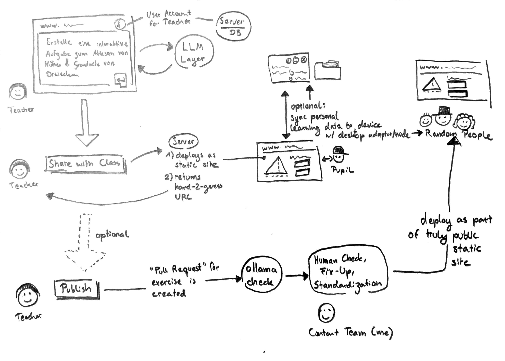

`thia` (working title) is a work-in-progress system to allow both creating (with LLMs) and using interactive learning experience (e.g.: trainer for Ancient Greek alphabet, visualization of the time-independent Schrödinger equation, mental multiplication practice).

## Users

`thia` has three principal user groups: 

1. Teachers, who draft and create interactive exercises, and share them with their class (and optionally publish them)
2. Students/Pupils who practice these exercises. They may or may not want to sync/backup their learning progress.
3. Random People, who can freely access the published exercises on the web

Here is a rough sketch:

There are sort of two more user groups we can consider:

4. Power Users, who may be in any of the aforementioned groups, and may want to use the underlying tech to e.g. build their own plugins or views
5. The "Content Team", who edits and actually publishes the teacher's drafts to the general public (currently, me) 

## Main Software Components

Based on the flow above, I suggest that I mainly need the following:

1. The **teacher tool**, a "classic webapp", where teachers can sign-in, create (=vibecode) exercises, manage their existing exercises, and share them
2. A **learner site**, a simple static website, allowing learners to do exercises (without sign-in), as well as decent search etc.
3. A locally installable **sync node**, optionally allowing users to download/sync their learning progress 

There is a bunch of other components I'm iterating and testing around this project but they are mostly ...
1. *boring* (local admin suite to run data housekeeping, landing page),
2. *currently have me as the sole user* (more advanced "learner site" with a more flexible UI and connections to locally installed software), 
3. *or can reuse the same infra and deploy logic as the main components* (another "teacher tool" around interactive visualizations without active learning)

...therefore I'm considering these more or less out of scope for the devops class, I just mention them because I will probably still write devops stuff for them at some point, and because they are already in this monorepo in various state of usability.

## Idiosyncrasies 

Before the rest of the plan, I want to list some factors unique to this project that influence devops decisions to various degrees.

1. For compliance, ethical and pragmatic reasons, I want to store as little as possible user data.
2. For various (sort of complicated) reasons, most data and even logic (=interactive learning views) are represented as typed yml files. User learning data is kept as individual yml files in browser OPFS, when synced to desktop they become "real files" on disk.
3. I want to try to get teacher at German schools to test & use `thia` — if I actually get any traction in this area, semi-predictable things may happen, such as:
    - I am required to comply with bespoke and elaborate privacy/data policies
    - Software needs to be compatible with weird bespoke IT/APIs/auth systems
    - It may be useful to make a spin-off frontend/app for a specific context of client (e.g. a school or Bundesland)
4. One of the core ideas of `thia` is to generate good interactive learning experiences from a quickly vibecoded spec. To make this viable, I have to *go with the flow* of the changing AI offerings, providers, models, etc. This is mostly application logic/changed env keys, but can influence infra; example: When testing locally, it is wise to pipe LLM calls to locally installed Claude (to burn flatrate subscription budgets instead of money), yet the same flow can obviously not work on a deployed app.
5. With all this vibe-coding, and the ambition to scale the scope to many many learning topics, I need not just logging of application health/errors, but also AI-level logging, both of stuff like token usage and time-on-task, but also output quality, not just as judged by the teacher who used it, but also via learner feedback or actual user stats flowing back. This calls for a fairly elaborate setup & dashboard.
6. Interactive experiences that teachers consent to publish should flow back to a content team (me), be checked and improved and permanently published, in source code. This is a weird boundary-crossing from dynamic user data to source-controlled code. I am not entirely sure how to model this yet (both at scale of "just me" and when imagining a bigger "content team")
7. I plan to do this project "for real" if user tests seem promising, but I'm running it on a low, personal budget. Thus I expect non-zero traffic, and also low cost is paramount ($5 vs $30 matters). This matters for *aaS choice.
8. To allow to effectively vibe-code educational experiences, it is necessary to ensure a secure result (currently the experience is built into a fairly locked-down iframe), but also to provide interesting and powerful affordances (e.g.: microphone access after consent, or a 3D visualization JS library). This provides a range of interesting challenges (and I'm unsure how to solve them); but I'm also unsure how much of this will be pure application logic and how much will bleed into infra (e.g. will I host a mini CDN for JS libraries...?), so I'm not including this in the plan yet.

## DevOps: The Plan

Infra/CICD/DevOps wise I'm currently thinking in three parts:

1. **Teacher Tool**
2. Anything static, such as the **learner site**
3. Anything that runs "**local**", e.g. the content publishing process stuff or the node that syncs user data

### Teacher Tool

This should be a standard classic web app (server, traditional database at least for auth, web frontend).
Stack doesn't actually matter too much; I started with Rust+React for now (auth/db to be implemented soon).

I plan to deploy it on a Hetzner VM (probably) and to containerize it. I don't believe scaling will be much of an issue in any reasonable timeframe, but update-without-downtime sounds nice.
A classic split of `dev`, `staging` and `prod` also feels reasonable here. I will try to keep the three environments as aligned as possible.

I'm not quite sure about the exact container architecture and stack yet. I'm also lacking the mental model to judge whether this minimal-ish container setup warrants something like kubernetes or not.

### Learner Site

This is a very boring static site, (probably) pure client side (generated partly by the teacher tool and partly from repo data, which is the weird part). It's also inherently stateless.
As such, containers feel overengineering, and I think I would get a lot of mileage out of a plain reproduceable VM here (again using Hetzner).

I'm a bit concerned about surprise bills from e.g. someone hammering a static asset, so either I have to plan out security here, or I may after all move to a simple PaaS like Netlify or Cloudflare (which have very generous free tiers for static sites).

Monitoring can be pretty basic, and I think a `prod` environment that more or less can be reproduced locally (not too hard for a bunch of HTML files) is enough. 

On the other hand, since I want to (at least mid-term) allow users to sync their data (still client-side on the learner site, but dynamic) and to give feedback (e.g. via a form) and to maybe track pseudonymous learning data (REST API to my teacher tool/server), maybe it would be wise to have containers here after all, and a `staging` environment for confidently testing.

### Local Stuff

Here, the ambition is mostly to...

1. Make builds (etc.) reproducible, so that if my dev machine dies I can quickly get stuff up and running again (e.g. the content-team-publish flow)
2. Have a basic release mechanism for parts that may eventually interest other people, e.g. the sync node 

I don't think I need much more here than a standardized task runner (like `just`) and maybe an integration in the GitHub CI/CD or just API (for tagged releases).

